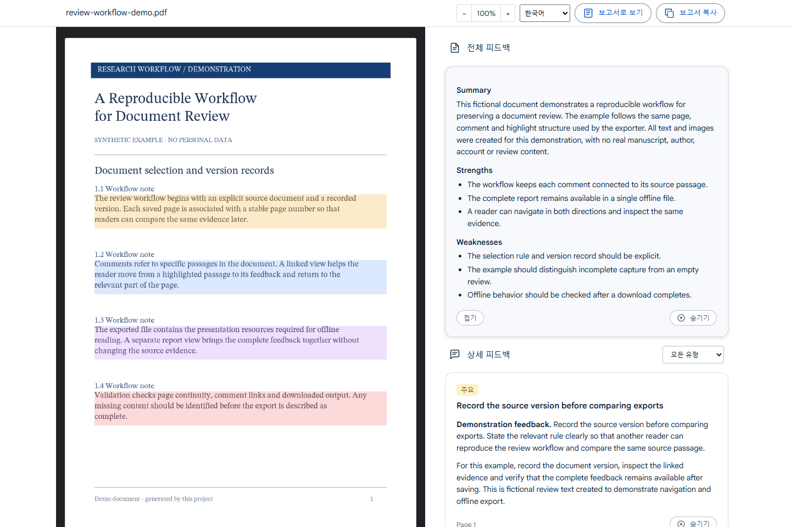

# Deep Review HTML Exporter

[English](README.md) · [설치](docs/chrome-extension-install.md) · [개인정보 처리](docs/privacy.md) · [릴리즈](https://github.com/hcscat/deep-review-downloader/releases)

열어 둔 Deep Review 논문 리뷰를 **상호작용 가능한 단일 HTML 파일**로 저장합니다. 오프라인에서 논문과 피드백을 읽고 하이라이트와 코멘트를 양방향으로 탐색할 수 있습니다.

**hcscat**이 만든 독립 도구이며 Google 공식 제품이나 승인을 받은 제품이 아닙니다. 접근·저장 권한이 있는 문서에만 사용하세요.


## 주요 기능

- 논문 페이지 이미지, 전체 피드백, 코멘트·심각도·하이라이트 연결 보존
- 더 보기·접기, 보고서·코멘트 전환, 하이라이트와 코멘트 간 양방향 이동
- 50–500% 확대·축소, 심각도 필터, 숨기기·복원, 전체 보고서 복사
- 이미지·스타일·글꼴·실행 코드를 내장하여 로그인·인터넷 없이 열람
- 영어 기본과 한국어 지원: 확장은 Chrome 표시 언어를 따르고 다른 언어는 영어로 표시합니다. 저장 뷰어는 English/한국어 선택이 가능합니다. 리뷰 원문은 번역하지 않습니다.

## 예시 화면

저장소가 생성한 **가상 문서를 실제 확장으로 내보낸 결과**입니다. 실제 논문·저자·계정·리뷰 자료는 사용하지 않았습니다.



| 하이라이트·코멘트 연결 | 전체 보고서 |
| --- | --- |
|  |  |

## GitHub Releases에서 설치

확장 배포는 **GitHub Releases로만** 진행합니다. Chrome 웹스토어 등록은 보류했습니다. 최초 릴리즈 게시 전에는 다운로드 항목이 없을 수 있습니다.

1. [Releases](https://github.com/hcscat/deep-review-downloader/releases)에서 `deep-review-html-exporter-v<버전>.zip`을 받습니다. 자동 생성되는 Source code ZIP과 구분하세요.
2. 필요하면 `SHA256SUMS.txt`와 해시를 비교한 뒤 계속 보관할 폴더에 압축을 풉니다.
3. `chrome://extensions` → **개발자 모드** → **압축해제된 확장 프로그램을 로드합니다**에서 `manifest.json`이 있는 폴더를 선택합니다.
4. 확장을 고정하고 평소처럼 Deep Review에 로그인합니다. 리뷰를 연 뒤 확장 버튼을 한 번 누릅니다.
5. **HTML 파일을 저장했습니다** / ✓ 배지가 표시되면 완료입니다. 기본 위치는 Chrome 다운로드 폴더 아래 `DeepReview/`입니다.

설치에 Node.js·Python은 필요하지 않습니다. GitHub 자동 업데이트는 제공하지 않으므로 새 버전을 받아 설치 폴더를 교체하고 확장과 원본 리뷰 탭을 새로고침하세요. [자세한 설치 안내](docs/chrome-extension-install.md).

## 개인정보와 한계

Google 비밀번호·인증 쿠키·토큰·사이트 저장소·전체 방문 기록을 읽지 않습니다. 개발자 서버 업로드나 분석·광고 기능은 없습니다. 권한은 `activeTab`, `scripting`, `downloads`이며 상시 호스트 권한은 없습니다.

**저장 HTML에는 원문의 개인정보·비공개 연구 내용이 포함될 수 있습니다.** 문서·리뷰 식별자, 출처 URL과 저장 시각도 포함합니다. 자동 익명화·암호화는 하지 않으므로 실제 결과물을 공개 이슈에 첨부하지 마세요.

참조 URL의 사용자명·비밀번호·쿼리·프래그먼트는 제거합니다. 쿼리 기반 링크는 동작이 달라질 수 있습니다. URL 경로·본문·수식·이미지 속 정보까지 자동 삭제하지는 않습니다. 출처 URL은 리뷰 식별에 필요한 문서 식별자를 별도로 보존합니다. [상세 처리 설명](docs/privacy.md).

PDF는 이미지이므로 원본 PDF의 텍스트 검색·벡터 재렌더링을 지원하지 않습니다. 보고서는 수집한 피드백으로 재구성합니다. 저장 전에 DOM에서 사라진 코멘트는 누락될 수 있으며, 원본이 총 개수를 제공하지 않으면 완전성을 증명할 수 없습니다. Google 화면 변경 시 업데이트가 필요할 수 있습니다. 모드·필터·스크롤에 원본 사이트가 자체 통신할 수 있으며 인증·할당량·접근 제한을 우회하지 않습니다.

## 개발과 릴리즈 준비

Node.js/npm과 Python 3.10 이상이 필요합니다.

```powershell
python -m pip install -r requirements.txt
npm ci --ignore-scripts
npm run typecheck
npm run format:check
npm run build
npm run audit:source
npm run release:prepare
```

실제 논문·로그인 데이터 없이 빌드합니다. 개발 설치 폴더는 `dist/deep-review-extension/`입니다. `release:prepare`는 `dist/release/`에 버전 ZIP과 체크섬을 로컬로 생성하며 커밋·태그·푸시·외부 게시를 실행하지 않습니다.

[브라우저 테스트](docs/chrome-extension-development.md) · [두 수정의 변경 전후 설명](docs/security-changes.ko.md) · [릴리즈 절차](docs/releasing.ko.md).

주요 파일은 [Source map](README.md#source-map)을 참고하세요. `store/`는 이전 웹스토어 초안과 이미지이며 제출은 보류 상태입니다. 자체 코드의 재사용 라이선스는 아직 정하지 않았습니다. 글꼴 OFL과 [서드파티 안내](THIRD_PARTY_NOTICES.md)는 유지합니다. 버그는 [GitHub Issues](https://github.com/hcscat/deep-review-downloader/issues)에 개인정보를 제거한 가상 예제로 제보해 주세요.
