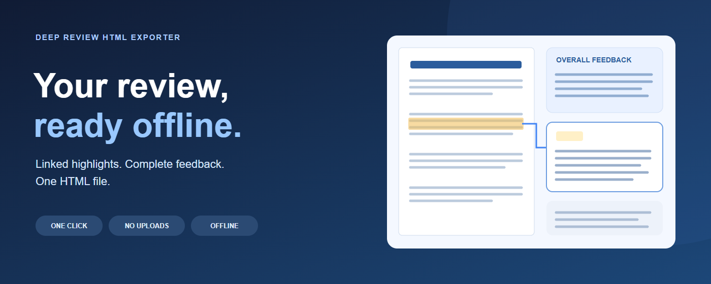
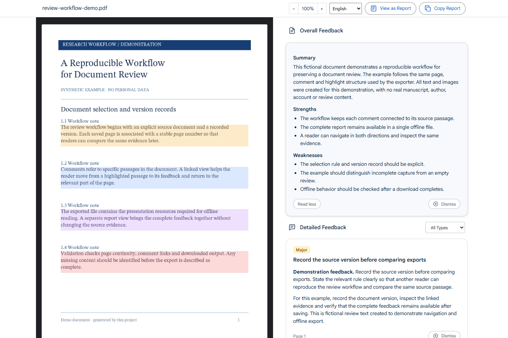
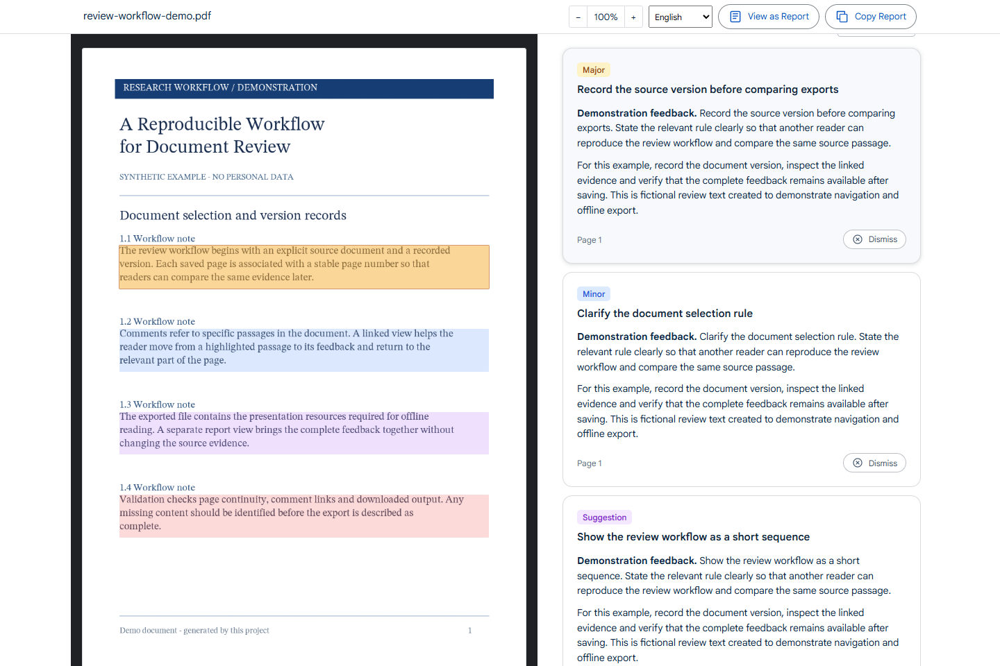
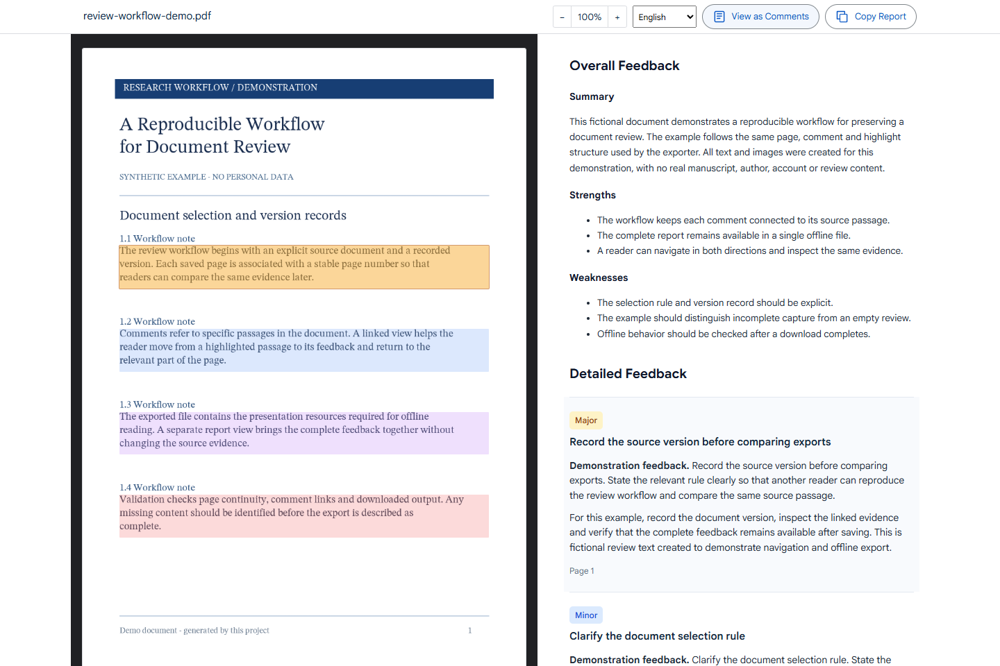

# Deep Review HTML Exporter

[한국어](README.ko.md) · [Install](docs/install.md) · [Privacy](docs/privacy.md) · [Releases](https://github.com/hcscat/deep-review-downloader/releases)

Save the open Deep Review as **one interactive, self-contained HTML file**. Read the paper and its feedback offline, with linked highlights, comments and a complete report.

An independent tool by **hcscat**. Not affiliated with, endorsed by, or produced by Google. Use only with documents you are authorized to access and save.



## Features

- Paper page images, overall feedback, complete captured comments and linked highlights.
- Read More/Less, Report/Comments, and bidirectional passage/comment navigation.
- PDF zoom from 50% to 500%, severity filters, Dismiss/Restore and Copy Report.
- Embedded images, styles, fonts and runtime: no login or internet needed for the saved file.
- English fallback and Korean extension UI, following Chrome's display language. The saved viewer has an English/한국어 selector. Review content is never translated.

## Screenshots

Actual extension exports of **fictional documents generated by this repository**. No real manuscript, author, account or review data is shown.



| Linked feedback | Complete report |
| --- | --- |
|  |  |

[See the Korean interface](docs/images/overview-ko.png).

## Install from GitHub Releases

Distribution is through **GitHub Releases only**. Chrome Web Store publication is on hold. Downloads may be empty before the first release is published.

1. Open [Releases](https://github.com/hcscat/deep-review-downloader/releases) and download `deep-review-html-exporter-v<version>.zip`. Choose the extension asset, not GitHub's automatic source-code ZIP.
2. Compare its SHA-256 with `SHA256SUMS.txt` if desired, then extract it into a folder you will keep.
3. Open `chrome://extensions`, enable **Developer mode**, click **Load unpacked**, and select the folder containing `manifest.json`.
4. Pin **Deep Review HTML Exporter**, sign in to Deep Review normally, open a review and click the exporter once.
5. Wait for **HTML file saved** / the ✓ badge. Open the downloaded HTML; the default folder is `DeepReview/` under Chrome's download directory.

Release installation needs no Node.js or Python. GitHub does not automatically update unpacked extensions: download a new release, replace the installed files, reload the extension and refresh the source review tab. [Installation and troubleshooting](docs/install.md).

## Privacy and limitations

No Google passwords, authentication cookies/tokens, site storage or full browsing history are read. Reviews are not uploaded to a developer server or used for analytics. Permissions: `activeTab`, `scripting`, `downloads`; no persistent host permissions.

**Output can contain personal or confidential paper/review content**, document/review identifiers, source URL and export time. It is neither anonymized nor encrypted. Do not attach real exports to public issues.

Reference links lose URL credentials, queries and fragments; query-based links may stop working. URL paths, visible text, formulas and page pixels are not automatically redacted. The source URL separately retains the document identifier needed to identify the review. [Data handling](docs/privacy.md).

Paper pages are images, not the original searchable/vector PDF. Report is reconstructed from captured feedback. Previously dismissed content may be absent; missing source totals limit completeness checks. Google's UI may change. Mode/filter/scroll events can trigger the source site's own requests. Authentication, quotas and access controls are not bypassed.

## Build and verify

Requires Node.js/npm and Python 3.10+.

```powershell
python -m pip install -r requirements.txt
npm ci --ignore-scripts
npm run typecheck
npm run format:check
npm run build
npm run audit:source
```

Builds use authored CSS, bundled licensed fonts and source code only; no real paper or Chrome login profile is needed. Load `dist/deep-review-extension/` for development.

[Development/tests](docs/chrome-extension-development.md) · [Security fixes: before/after](docs/security-changes.md).

```powershell
npm run release:prepare
```

This creates a versioned ZIP and checksums in `dist/release/` locally. It does **not** commit, tag, push, create a GitHub release or submit to the Web Store. [Release checklist](docs/releasing.md).

## Source map

| Path | Purpose |
| --- | --- |
| `extension/src/background.ts` | User action and export task |
| `extension/src/capture.ts` | DOM capture, UI restoration, chunked transfer |
| `extension/src/snapshot.ts` | Validation, formatting allowlist, reference URL cleanup |
| `extension/src/export.ts` | Rendering, cancellation, job-specific download lifecycle |
| `extension/src/i18n.ts`, `extension/static/_locales/` | English fallback and Korean messages |
| `viewer/` | Offline UI, session state, language selector, styles and fonts |
| `scripts/` | Build, synthetic fixtures, regression tests and publication audits |
| `docs/` | Installation, privacy, screenshots and release instructions |
| `store/` | Earlier Web Store draft materials; submission is on hold |

No software reuse license has been selected yet; do not assume an open-source license. Fonts retain their OFL licenses: [third-party notices](THIRD_PARTY_NOTICES.md). Report bugs through [GitHub Issues](https://github.com/hcscat/deep-review-downloader/issues), using fictional examples and removing private details first.
